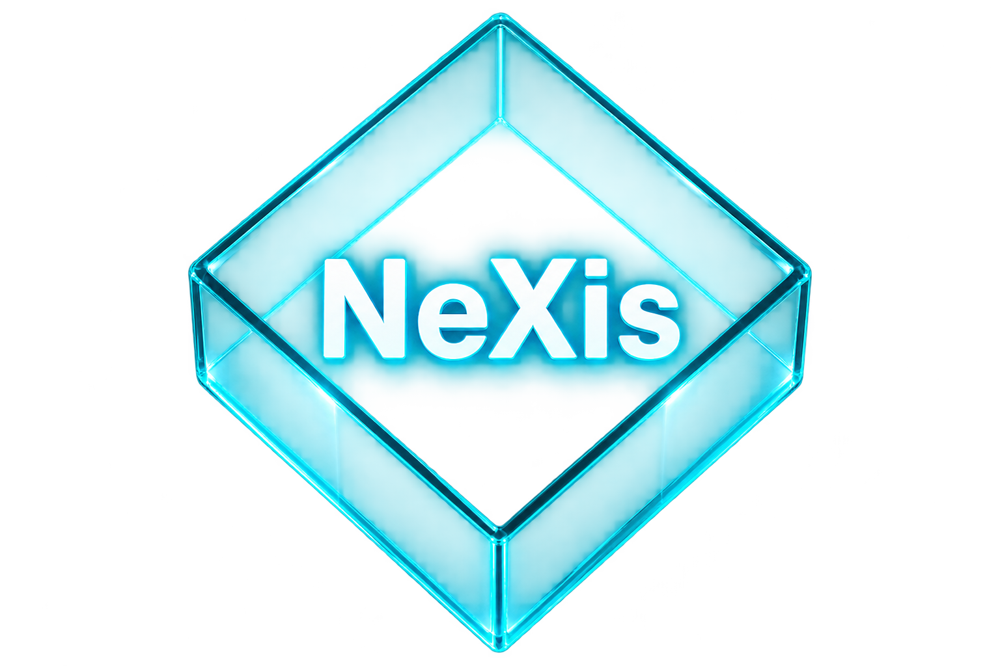

  

<h1 align="center">NeXis</h1>

  Modular Artificial Intelligence architecture

> 🚧 **Under Active Development**
>
> This architecture is currently under active development. Its architecture, features, and documentation are evolving and may change as research and implementation progress. **Not yet recommended for production use**.

# NeXis — A Modular Architecture for Transparent and Trustworthy AI

**NeXis** is an open-source, experimental Artificial Intelligence architecture developed within [The Glass Box AI Project](https://glassboxai.dev/). It explores an alternative to opaque, monolithic AI systems through a modular approach that separates knowledge activation, semantic processing, logical reasoning, adaptive intelligence, linguistic processing, and security into specialized, independently inspectable components.

NeXis investigates two complementary research directions: improving the transparency, reliability, and controllability of Large Language Models (LLMs), and developing alternative neuro-symbolic approaches to adaptive intelligence. Its architecture integrates research modules including **aXiom, veXtor, fliXer, μNeX, Ximplio, and ZarX**, with an emphasis on explainability, traceability, human oversight, and reproducible experimentation.

The long-term objective is to investigate AI systems whose internal operations can be examined, evaluated, and understood rather than treated as inaccessible Black Boxes.
